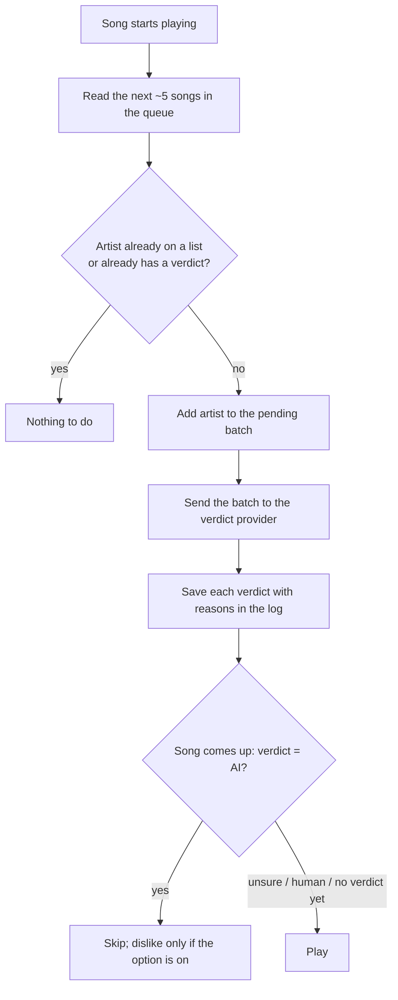

# AI artist checker: design

Status: approved by Wai 2026-11-11 ("Build after review fixes").

## Why

The extension blocks artists on two kinds of list: the user's own lists and
the Soul Over AI list (1375 artists). The Soul Over AI list stopped growing:
its newest entry is 2026-02-16. Every AI artist that appeared after that plays
unchallenged. Wai spots them herself by their thumbnails and by the lack of
any history from before generative music tools existed.

The checker does that spotting automatically, one step ahead of playback:
while a song plays, it investigates the artists coming up in the queue and
skips the ones it judges AI before they play.

## Goals

- Judge whether an upcoming artist is AI before their song plays.
- Skip a song whose artist is judged AI. Dislike it too only when the popup
  option "Also dislike blocked songs" is on (skip-only is the default; that
  option ships separately, before this feature).
- Keep a quiet log of every verdict in the popup, with reasons, and let the
  user overrule any verdict in one click.
- Run on Wai's Claude subscription for her own use, through a local helper.
- Let other users plug in their own model instead (an Anthropic API key
  first; any other endpoint later).

## Non-goals

- Judging songs by their audio. The checker reads public information about
  the artist; it does not analyse sound itself (it may read Deezer's audio-based
  AI label, see Signals).
- A shared or public verdict database. Verdicts stay in the user's browser.
- On-screen notices while listening. Wai chose a quiet log.

## Anti-goals (failure even if it works)

- **Skipping a real indie artist.** Wai: a real indie artist being skipped is
  the worse mistake, worse than an AI artist slipping through now and then.
  The checker must lean cautious: unsure means play.
- Stalling or breaking playback when the checker is slow, offline or
  misconfigured. Any failure means the song plays as if there were no checker.
- Re-checking the same artist over and over (cost against the subscription
  or the user's API bill).

## How it behaves

1. **Trigger.** Each time a new song starts, read the upcoming queue from the
   page (`ytmusic-player-queue-item` elements were present on the live site
   on 2026-11-11). Take about 5 songs ahead: title, artist line, thumbnail URL.
2. **Shortcut.** Drop artists that are already on a block list (they are
   handled by the existing matcher) or that already have a saved verdict.
3. **Batch.** Send the remaining artists to the verdict provider in one
   request. Exception: if the very next song's artist is unchecked while a
   batch is already running, send it alone so it does not wait behind four
   others.
4. **Verdict.** For each artist the provider returns `ai`, `human` or
   `unsure`, a confidence, and 2 or 3 one-line reasons citing the signals.
5. **Act.** When a song comes up whose artist's verdict is `ai`, skip it
   through the same path as list blocks (`blockCurrentSong`), so the dislike
   option applies. `human`, `unsure`, or no verdict yet: play.
   **A verdict that lands after its song has started never skips that song**
   (Wai, 2026-11-11: "Noskip mid song"); it applies from the artist's next
   song on. So the first song after opening YouTube Music is never caught.
6. **Log.** Every verdict appears in a new popup tab, newest first: artist,
   verdict, reasons, date. Each `ai` verdict has a "Not AI" button that flips
   it to `human` for good; each `human`/`unsure` has a "Block" button that
   adds the artist to the user's own artist list.
7. **Memory.** Verdicts are saved per artist in `chrome.storage.local` and
   never re-checked automatically. (Re-checking `unsure` after some weeks is
   left open, see below.)

## Signals the provider is told to use

From a web survey on 2026-11-11 (guides agree no single tell is proof), in
rough order of strength:

1. **Deezer AI label.** Deezer detects generator traces in the audio and
   labels albums. No public API; the provider looks the artist up on Deezer.
2. **No human footprint.** No label, tour dates, interviews, real social
   accounts, credits naming people; member photos that look generated.
3. **Short, heavy catalogue.** Nothing released before 2024; frequent
   releases. (Soul Over AI's own top markers: AI visuals 1009 artists,
   anonymous 847, high output 784.)
4. **AI-style art.** The thumbnail and other covers; repeated motifs.
5. **Tracker flags.** SoullessMusic, SlopTracker, Spotify's "AI Persona"
   badge, the artist's own AI disclosure.

**Decision rule (anti-goal above):** `ai` only when at least two signals
agree, or one strong one (a Deezer label, the artist's own disclosure).
The thumbnail never decides alone: many human indie artists use AI or stock
art. Anything less is `unsure`.

## Providers

The extension talks to a "verdict provider" chosen in the popup. All
providers take the same input (a list of artists with a song title and a
thumbnail URL each) and return the same output shape.

1. **Local helper (Wai's setup).** A small program on the user's machine
   listening on `localhost`. For each batch it runs Claude Code headless
   (`claude -p`), which can search the web, fetch pages and read images, and
   uses the user's Claude subscription. Chrome on Windows reaches a helper in
   WSL over `localhost`. Personal use only.
2. **Anthropic API key.** The extension calls the Messages API directly with
   the user's key: model `claude-opus-5-5`, the `web_search_20260209` and
   `web_fetch_20260209` server tools, and the thumbnail as an image block.
   The user pays per lookup.
3. **Later: other endpoints.** Any endpoint that accepts the same input and
   returns the same output (an OpenAI-style API, a local Ollama model).

No provider configured: the checker is off and the extension behaves as it
does today.

## Decisions made by Claude (not yet confirmed by Wai)

Settled after a builder review on 2026-11-11; each is Claude's call.

- **Where calls run.** A new MV3 service worker makes every provider call;
  `content.js` sends it the queue over extension messaging. Manifest gains
  host permissions for `http://localhost/*` and `https://api.anthropic.com/*`.
  One worker also means one set of in-flight requests across several YTM tabs.
- **Helper security.** The helper listens on `127.0.0.1` only and requires a
  random shared token (generated by the helper on first run, pasted into the
  popup once) on every request, and rejects requests whose `Origin` is not a
  `chrome-extension://` origin. Reason: it runs `claude -p` with web access on
  the user's subscription, so any web page reaching it would be a hole.
- **Which artist.** Every credited artist on a song is checked (the artist
  line before the first "•", split on "," and "&"). A song is skipped if any
  credited artist's verdict is `ai`. Verdicts are keyed by the YTM channel ID
  when the queue item exposes one, otherwise by the normalised lowercase name.
- **The extension enforces the decision rule, not just the prompt.** The
  provider returns, per artist, the list of signals it found (from the five
  above, by fixed ids). The extension downgrades `ai` to `unsure` unless the
  list holds two distinct signals or one strong one (Deezer label, own
  disclosure). Missing artists or malformed output count as no verdict.
- **Thumbnail.** Sent as its URL (YTM thumbnails are public image URLs); the
  helper downloads it for Claude Code. Image evidence is best-effort.
- **Deezer.** Best-effort. When the lookup fails, the other signals still
  apply; the result is more often `unsure`, which plays.
- **Concurrency and cost.** The helper accepts concurrent requests. The API-key
  provider has a daily cap on artists checked, default 50, set in the popup;
  past the cap, new artists get no verdict (they play).
- **Prompt injection.** Pages the model reads are data. The enforced decision
  rule above means one manipulated page cannot produce an `ai` verdict alone.
- **Skip-only option first.** The "Also dislike blocked songs" option and
  `blockCurrentSong` are being merged before this work starts (task in
  progress 2026-11-11); this plan builds on them.

## Revisions after the adversarial review (Claude's calls, 2026-11-11)

An adversarial review ("build with changes") and a live look at the queue
changed these points. They override the matching items above.

- **Queue facts (checked live).** Upcoming `ytmusic-player-queue-item`
  elements give title and artist line but **no links, so no channel IDs**;
  only the first ~2 thumbnails are loaded, the rest are placeholders. So:
  verdicts are keyed by the **whole artist line** (normalised lowercase),
  never by splitting on "," or "&" (that breaks "Earth, Wind & Fire",
  "Tyler, The Creator"); the provider gets the whole line and works out who
  the main act is. Thumbnails are optional evidence.
- **Cheap first pass before any model call.** The extension fetches the
  artist's YouTube Music page itself (it has the user's session) and reads
  first release year, release count and subscriber count. Only artists that
  look suspicious there (first release 2024 or later, or very high output)
  go to the model. Cuts model calls by roughly an order of magnitude and
  stops the checker eating Wai's Claude Code usage.
- **Long calls.** The helper takes a job and returns a job id at once; the
  service worker polls every ~10 s and keeps pending jobs in
  `chrome.storage.session`, so Chrome stopping an idle worker loses nothing.
  The API-key provider streams.
- **Helper hardening.** `claude -p` is started with an argument array (never
  a shell string), in an empty scratch folder, with only WebSearch and
  WebFetch allowed (no Bash, Edit, Write; Read only inside the scratch
  folder). Thumbnails are downloaded only from Google image hosts
  (`*.ytimg.com`, `*.ggpht.com`, `*.googleusercontent.com`) with a size cap.
  The shared token is the real guard (an `Origin` check alone can be faked);
  the helper also checks the `Host` header and answers CORS preflight.
  Token and API key are stored with `chrome.storage.local.setAccessLevel`
  limited to trusted extension pages, not content scripts.
- **Storage listener.** Verdicts get their own storage key and the existing
  `chrome.storage.onChanged` listener in `content.js` reacts only to the
  block-list keys; otherwise every verdict write would re-download the Soul
  Over AI list.
- **Existing bug to fix on the way.** `checkAndSkip` ignores a song whose
  title equals the last blocked title, whatever the artist; it must compare
  artist and title.
- **Usage limits visible.** The popup shows helper health (reachable, token
  ok) and a "checker paused" state when the subscription or API rate limit
  is hit, so silence never looks like "no AI found".
- **Cost caps.** At most 3 web searches per artist; a cheap model may do
  the first look and the main model only the hard cases.
- **Verdicts expire.** `ai` and `unsure` verdicts are re-checked after 60
  days; artists collect human evidence over time.
- **Verify before building.** First plan step: confirm Windows Chrome
  reaches the helper in WSL from the service worker, and what an artist page
  fetch returns.

## Skip rule (Wai, 2026-11-11: "Build after review fixes")

Supersedes "Act" and the decision rule above. The checker **skips only on
hard evidence the extension can verify**: the artist is on a tracker list,
or a Deezer album of theirs carries Deezer's AI label (the helper or
extension confirms the label on the page, not just the model's word). An
`ai` verdict resting only on the model's judgement is shown as
**"suspected"** in the quiet log with a Block button, and the song plays.

## Constraints

- Chrome extension, Manifest V3, plain JavaScript, no build step (as today).
- Must work on YouTube Music's new `ytmusic-miniplayer` layout and keep the
  old `ytmusic-player-bar` one.
- Verdicts and settings live in `chrome.storage.local`; the API key too.
- Tests run in Node without a browser, like the existing `tests/*.test.mjs`.

## Left to the builder

- The helper's language, port, and how it is started.
- The exact prompt for the provider, within the signals and decision rule
  above.
- The output schema's exact field names.
- Timeouts and how the extension recovers from a dead or slow helper (the
  anti-goal sets the rule: fail open, the song plays).
- Popup layout of the log tab, within the existing popup style.

## Open

- Whether `unsure` verdicts are re-checked after a while.
- Whether SoullessMusic can be added as a second ready-made list (no bulk
  download found).
